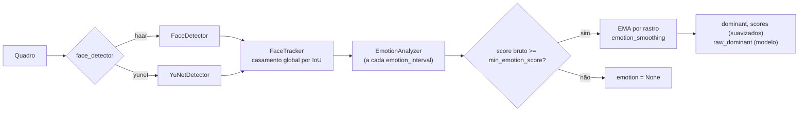

# Plano mestre de evolução

Data: 17/10/2026. Este documento resume o ciclo de modernização de 17/10. O histórico de produto, os ADRs e as propostas R1–R9 continuam em [EVOLUTION.md](EVOLUTION.md); o diagnóstico de ambiente está em [PHASE1_DIAGNOSTIC.md](PHASE1_DIAGNOSTIC.md).

## 1. Resumo executivo

O EmotionAI chegou a este ciclo funcional e bem estruturado: 65 testes, API endurecida, dois modos de demonstração. O ciclo focou na **qualidade do resultado que o usuário vê**: o rótulo de cada rosto oscilava entre inferências, e o rastreador podia trocar IDs de rostos próximos. Também fechou lacunas de engenharia (CI sem lint/tipos, layout que quebrava ao redimensionar) e acrescentou um detector moderno opcional. Foram 17 testes novos (81 aprovados e 1 opt-in com o modelo real), nenhuma dependência nova e nenhum serviço pago.

## 2. Estado original

Ver a [auditoria](REPOSITORY_TECHNICAL_AUDIT.md). Em resumo: arquitetura em camadas com portas e injeção, já adequada; testes, lint e auditoria de dependências passavam; formatação falhava em um documento; o CI instalava faixas de versão e só rodava testes.

## 3. Objetivos do ciclo

1. Estabilizar a saída exibida sem esconder a saída do modelo.
2. Garantir a identidade dos rostos no rastreador, base de qualquer estado por pessoa.
3. Tornar o CI repetível e mais rigoroso.
4. Oferecer um detector melhor sem custo e sem quebrar o padrão.

## 4. Arquitetura-alvo

A arquitetura é a mesma; as mudanças entram pelas portas existentes:

## 5. Decisões e justificativas

| Decisão | Justificativa | Alternativa rejeitada |
|---|---|---|
| EMA por rastro, no `Track` | O estado vive e morre com a pessoa rastreada; não mistura rostos (problema visto em oarriaga/face_classification) | Moda de rótulos global; suavização no front-end (não valeria para clientes da API nem para as métricas) |
| Limiar de confiança antes da suavização | `min_emotion_score` sempre significou "confiança do modelo"; mantê-lo evita mudar seu significado | Limiar sobre pontuações suavizadas |
| `raw_dominant` no contrato | Transparência: clientes veem o que o modelo disse e o que foi exibido | Esconder a saída bruta |
| Padrão `0.5` ligado | A melhoria só tem valor se a demo a usar; `0` restaura o comportamento anterior | Padrão desligado |
| Casamento guloso global | Corrige a troca de IDs sem dependência nova; para poucos rostos, o resultado é próximo do húngaro | SORT (GPL, Kalman sem ganho medido) |
| YuNet opcional, só por variável de ambiente | O modelo não acompanha o repositório; apontar arquivos pela API seria superfície de ataque | Trocar o padrão para YuNet; baixar o modelo automaticamente |
| CI com `requirements-test.in` | Pins exatos dos pacotes diretos e ferramentas na mesma versão local e no CI | Lock completo agora (sem validação multiplataforma) |

## 6. Plano de migração

- Clientes que dependem do rótulo bruto: ler `raw_dominant` ou definir `EMOTION_SMOOTHING=0`.
- Painéis e exportações: a distribuição de expressões conta rótulos suavizados (os exibidos).
- Nada muda para quem não usa YuNet; o padrão continua `haar`.

## 7. Implementações executadas

| Entrega | Arquivos principais |
|---|---|
| Suavização temporal | `app/core/pipeline.py`, `app/core/tracker.py`, `app/core/config.py`, `app/backend/serializers.py`, `app/backend/schemas.py`, `app/frontend/*` |
| Rastreador global | `app/core/tracker.py` |
| Métricas coerentes com o overlay | `app/backend/services.py` |
| YuNet opcional | `app/core/detector.py`, `app/core/config.py`, `app/core/pipeline.py` |
| Layout responsivo dos gráficos | `app/frontend/style.css` |
| CI e dependências | `.github/workflows/tests.yml`, `requirements-test.in`, `requirements-dev.in` |
| Medição | `scripts/measure_smoothing.py`, `scripts/demo_server.py` |

## 8. Resultados verificáveis

Detalhes e comandos em [VALIDATION_REPORT.md](VALIDATION_REPORT.md).

| Medida | Antes | Depois |
|---|---|---|
| Testes | 65 | 81 (+1 opt-in) |
| `ruff format --check` | Falhava | Passa |
| CI | Só `pytest`, faixas de versão | Lint, formatação, tipos, testes; pins exatos |
| Trocas de rótulo, 600 quadros reais, 1 rosto | 9 (saída bruta) | 3 (suavizada), na mesma execução |
| Tempo de detecção p50, 1.210 quadros | Haar 8,19 ms | YuNet 3,53 ms (opcional) |
| Detecção a 30° (rotação sintética, 121 quadros) | Haar 1/121 | YuNet 120/121 |
| Largura da página após reduzir de 1280 para 375 px | 992 px | 375 px |

## 9. Segurança, qualidade e desempenho

- Segurança: nenhum novo caminho de arquivo controlável pela API; validação estrita dos novos campos; `pip-audit` limpo.
- Qualidade: os defeitos corrigidos têm testes que falhavam antes da correção.
- Desempenho: custo adicional desprezível por inferência (não medido isoladamente).

## 10. Riscos residuais

- YuNet validado só no vídeo de demonstração (um rosto frontal) e em rotação sintética; não detecta rostos girados a 45°. O padrão continua `haar`.
- CI novo ainda não executado no GitHub.
- Dependências transitivas sem lock.
- Inferência síncrona no loop de captura (R1).
- Uso responsável: expressões faciais não equivalem a emoções internas; ver a seção de conformidade em [EVOLUTION.md](EVOLUTION.md).

## 11. Roadmap

Ver [ROADMAP_AND_SKILLS.md](ROADMAP_AND_SKILLS.md).
