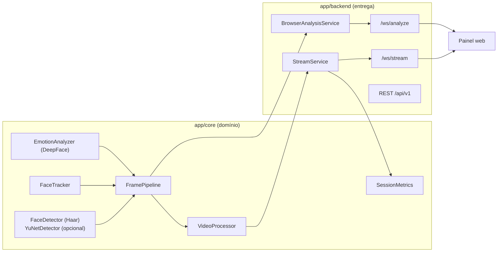

# Auditoria técnica do repositório

Data: 17/10/2026. Base: commit `1359b4a` (`feat/enterprise-hardening`), working tree limpa no início. Continua o [diagnóstico da Fase 1](PHASE1_DIAGNOSTIC.md), cujas prioridades foram conferidas contra o código atual.

## Classificação

Visão computacional + back-end/API + front-end de demonstração (aplicação full stack sem build de front-end). Python 3.13, FastAPI/Uvicorn, OpenCV 4 (Haar), DeepFace/TensorFlow, HTML/CSS/JS com Chart.js servido localmente. Sem banco de dados. Maturidade: projeto de portfólio em evolução ativa, com testes, CI, Docker e documentação. **Não é um projeto abandonado**: o ciclo anterior (16/10) já havia endurecido autenticação, ciclo de vida do stream e portabilidade.

## Arquitetura existente (preservada)

Portas por `Protocol`, injeção na fábrica `create_app()` e importação tardia de TensorFlow são boas decisões e foram mantidas. Não há motivo para Clean Architecture formal, microsserviços ou banco nesta escala.

## Situação das prioridades da Fase 1

| # | Prioridade da Fase 1 | Situação em `1359b4a` |
|---|---|---|
| 1 | Reprodutibilidade | Parcial: `requirements.in` com pins diretos, mas o CI instalava as faixas de `requirements.txt`; sem lint/tipos no CI → **tratado neste ciclo** |
| 2 | Estado operacional real | Resolvido no ciclo anterior (`/api/v1/status`, `analysis_enabled`) |
| 3 | Ciclo de vida concorrente | Resolvido no ciclo anterior (geração, timeout de parada → 409, envio paralelo com timeout) |
| 4 | Segurança de exposição | Resolvido no ciclo anterior (token na primeira mensagem, verificação de origem, CSP `'self'`) |
| 5 | Semântica de métricas | Resolvido no ciclo anterior (`expression_observations`) |
| 6 | Demo resiliente | Chart.js local já resolvido; **bug de layout responsivo encontrado e corrigido neste ciclo** |
| 7 | Escala com evidência | Pendente (R1, pool de inferência) |

## Achados deste ciclo

| # | Achado | Severidade | Impacto | Evidência | Status |
|---|---|---|---|---|---|
| A1 | Rótulo de expressão oscila entre inferências do mesmo rosto | Médio | Funcional/UX: leitura instável no painel e distribuição ruidosa | 9 trocas de rótulo em 600 quadros de um rosto (modelo real) | Corrigido (suavização) |
| A2 | Rastreador casa na ordem de criação: um rastro antigo pode ficar com a caixa do vizinho | Médio | Funcional: troca de IDs; com suavização, mistura de estado entre pessoas | Teste de regressão falhava antes da correção | Corrigido |
| A3 | Métricas refiltravam por `min_score`; com pontuações suavizadas, rótulos exibidos poderiam ficar fora da distribuição | Baixo | Dados: divergência entre overlay e métricas | Teste `test_metrics_count_every_label_shown_on_the_overlay` | Corrigido |
| A4 | Ao estreitar a janela, gráficos mantinham 919 px e a página ficava com 992 px em viewport de 375 px | Médio | UX mobile/rotação | Medição no navegador antes e depois | Corrigido |
| A5 | CI instalava faixas de versão e não rodava lint, formatação nem tipos | Médio | Manutenção: builds não repetíveis; problemas de estilo passam | `.github/workflows/tests.yml` original | Corrigido |
| A6 | `ruff format --check` falhava em `docs/EVOLUTION.md` | Baixo | Seria barrado pelo novo job de lint | Saída do ruff | Corrigido |
| A7 | `StreamFrameDataSchema` não documentava `analysis_enabled` | Baixo | Contrato OpenAPI incompleto | Comparação esquema × `services.py` | Corrigido |
| A8 | Haar Cascade é limitado para rostos inclinados/de perfil | Médio | Qualidade de detecção | Literatura e documentação do opencv_zoo; não medido aqui | Mitigado: YuNet opcional (não validado com o modelo real) |
| A9 | Dependências transitivas (TensorFlow etc.) não travadas | Médio | Reprodutibilidade | `requirements.in` só fixa diretas | Pendente: lock multiplataforma exige validação em Linux e Windows |
| A10 | `mypy` estrito cobre 4 módulos | Baixo | Tipagem parcial | `pyproject.toml` | Pendente |
| A11 | Inferência síncrona no loop de captura | Médio | Desempenho com vários rostos | Documentado como R1 desde o ciclo anterior | Pendente |

## Segurança

Revisão focada nas alterações deste ciclo:

- O caminho do modelo YuNet e a escolha do detector **não** são aceitos pela API (`extra="forbid"` → 422), seguindo a regra de `video_source`. Teste: `test_yunet_detector_cannot_be_switched_through_the_api`.
- `emotion_smoothing` validado (finito, `[0, 1)`) na configuração e com o esquema estrito do Pydantic.
- Nenhum segredo encontrado nos arquivos alterados. Nenhuma nova dependência.
- `pip-audit` sobre os pins diretos: nenhuma vulnerabilidade conhecida.

Não foram feitos testes intrusivos nem varredura de histórico Git por segredos neste ciclo.

## Desempenho

O custo da suavização é um dicionário de 7 entradas por rosto a cada inferência, desprezível diante da CNN. O casamento global calcula IoU para todos os pares rastro × detecção (antes também), e ordenar alguns pares é O(n log n). Nenhum benchmark comparativo de FPS foi feito; a latência amostral do modo câmera (29,5 ms) é da mesma ordem do ciclo anterior, mas é uma amostra única.

## Pendências

Ver [ROADMAP_AND_SKILLS.md](ROADMAP_AND_SKILLS.md).
